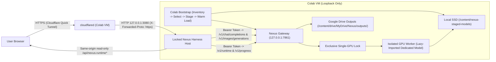

# Nexus Harness Architecture (v1.1.0)

Nexus Harness v1.1.0 runs a Colab-first, single-active-model runtime over DeepSeek Harness without modifying the agent loop or duplicating session persistence.

## Topology and trust boundaries

## Ownership boundaries

| Surface | Owner | Invariant |
|---|---|---|
| Model inventory, selection, SSD staging, warm load | Colab Bootstrap (`colab/model_inventory.py`, `colab/staging.py`, v1.1.0 notebook) | Stages 1 language model and 1 optional image model upfront; fails loud before Harness starts if load fails. |
| Single-model inference & GPU swap | Nexus Gateway (`127.0.0.1:7861`) + Isolated GPU Worker | Rejects unselected models (HTTP 400/409) and pre-readiness chat (HTTP 503); image generation atomically swaps LLM → Image → LLM inside one exclusive lock. |
| Native tool execution & session log | Harness Agent Loop (`@deepseek-ai/dsh-session`) | Gateway parses & validates model-specific tool calls (Qwen3-VL JSON, Qwen3.5/3.6 XML, GPT-OSS Harmony); Harness executes tools and appends `role: "tool"`. |
| Runtime UI | `nexus-runtime-ui` + `nexus-host` | Strictly read-only status badge, VRAM display, and live swap/denoising progress; zero model switching or loading controls in Harness. |
