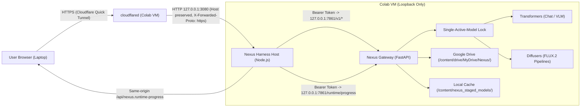

# Nexus Harness Architecture

Nexus Harness layers a Colab-first inference integration onto DeepSeek Harness without modifying the agent loop or duplicating session persistence.

## Topology and trust boundaries

## Ownership boundaries

| Surface | Owner | Security invariant |
|---|---|---|
| Session event log & history | Harness Host (`@deepseek-ai/dsh-session`) | Append-only; never stores raw image base64 (stores `ImageAttachmentRef`). |
| Model loading, inference, staging | Nexus Gateway (`127.0.0.1:7861`) | Loopback-only; requires timing-safe `Authorization: Bearer <NEXUS_API_KEY>`. |
| Single-active-model lock | Nexus Gateway (`ModelManager`) | Chat and diffusion serialize through one lock; previous model is unloaded before loading the next. |
| Native tool execution | Harness Agent Loop | Gateway parses and validates `<tool_call>` blocks into OpenAI `tool_calls`, never executes tools. |
| Browser-to-Host traffic | Harness WebServer + `HostConnectionService` | Exact `--trusted-host`, `Origin === Host`, `dsh-auth-*` `HttpOnly` + `SameSite=Strict` + `Secure` cookie. |
| Workspace browsing | `BrowseDirectoryPicker` + `WorkspaceRegistry` | Canonical `realpath` confinement to `allowedRoots`; breadcrumbs clamped at root. |
| Runtime progress UI | `nexus-runtime-proxy` -> `nexus-client` | Browser calls same-origin `./api/nexus.runtime-progress`; Host injects bearer token server-side. |

## Request flows

1. **Chat + VLM + Native Tools**: Browser -> Harness Host -> `LlmRuntime` (`llm-pi-ai` `nexus` route) -> `POST http://127.0.0.1:7861/v1/chat/completions` -> `tokenizer/processor.apply_chat_template(messages, tools=...)` -> streaming Qwen `<tool_call>` parser & schema validator -> OpenAI `tool_calls` -> Harness executes tool -> `role: "tool"` appended -> next turn.
2. **Image Generation (`nexus_generate_image`)**: Harness agent calls `nexus_generate_image` -> Host plugin calls `POST http://127.0.0.1:7861/v1/images/generations` -> Gateway acquires single-model lock, runs FLUX.2 adapter with `callback_on_step_end`, saves lossless PNG master to Drive, returns bounded rendition -> Host saves via `ctx.attachments.saveImage` -> Client `tool.call.toolview` renders durable attachment inline.
3. **Runtime Progress**: Client Session panel polls `./api/nexus.runtime-progress` -> Host proxy verifies owner cookie and fetches `http://127.0.0.1:7861/runtime/progress` with bearer token -> returns bounded JSON snapshot.
